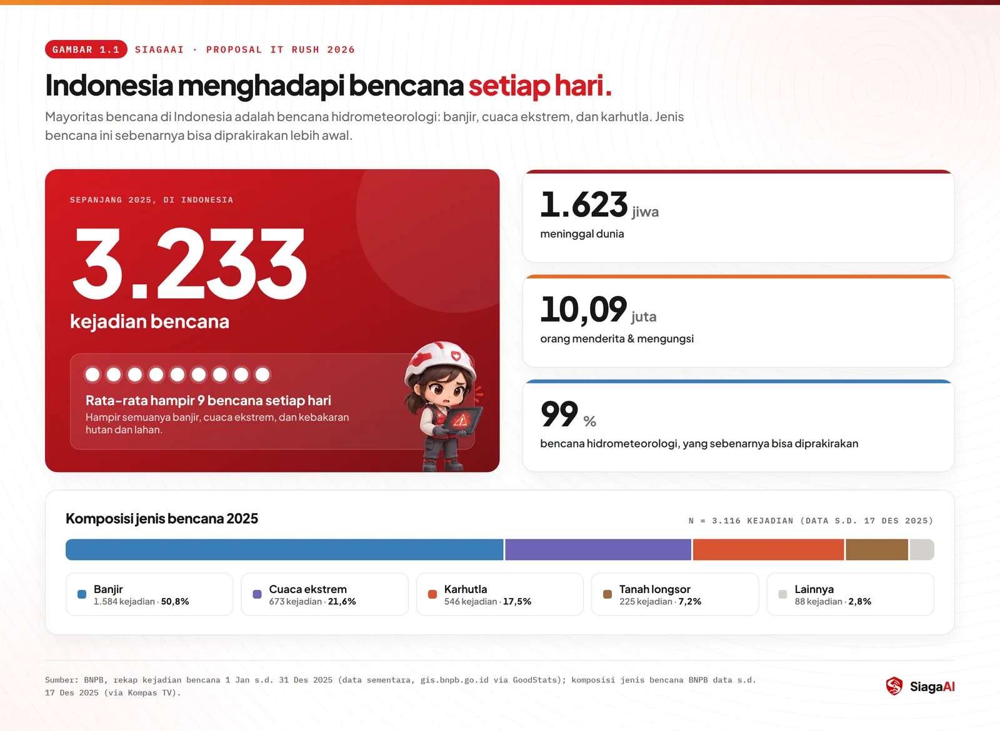
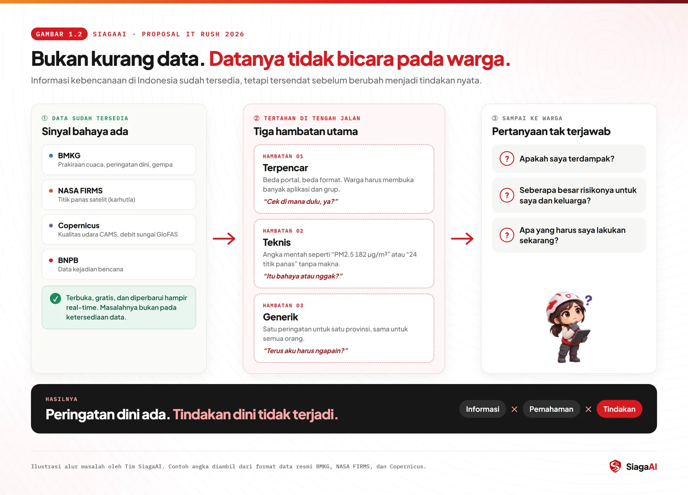
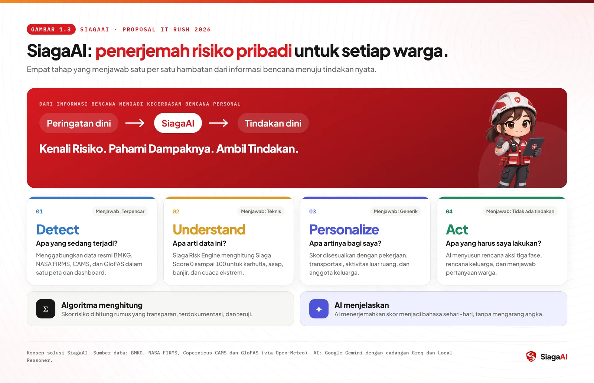
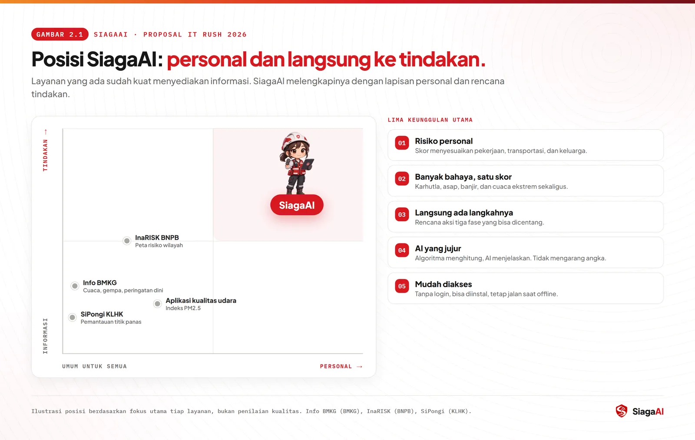
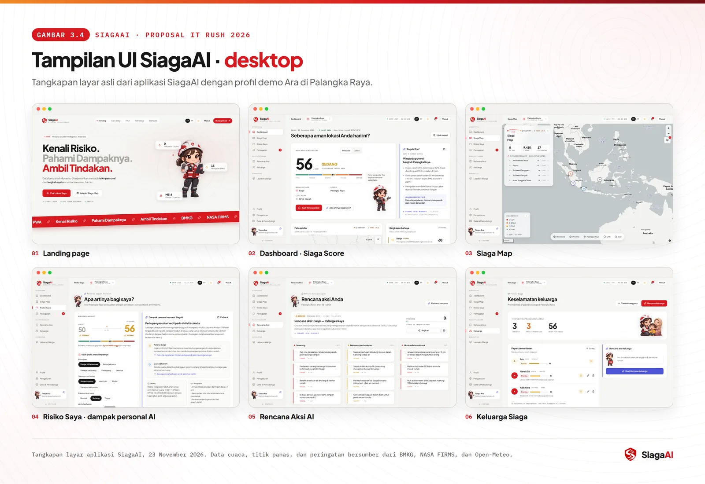
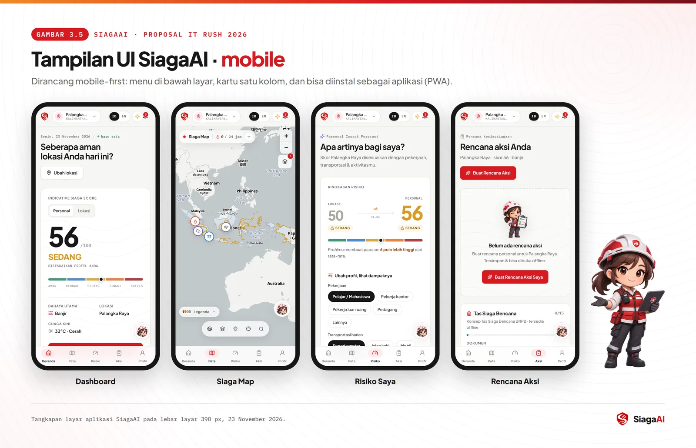
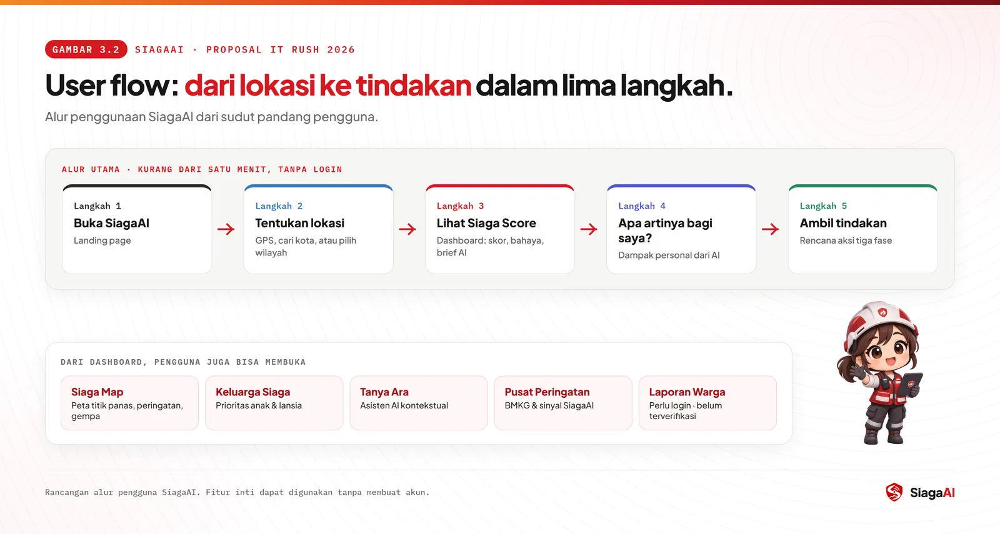
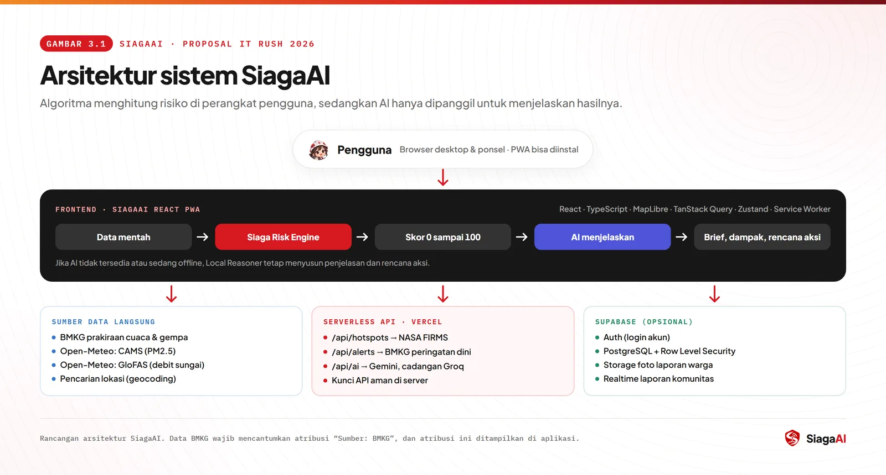
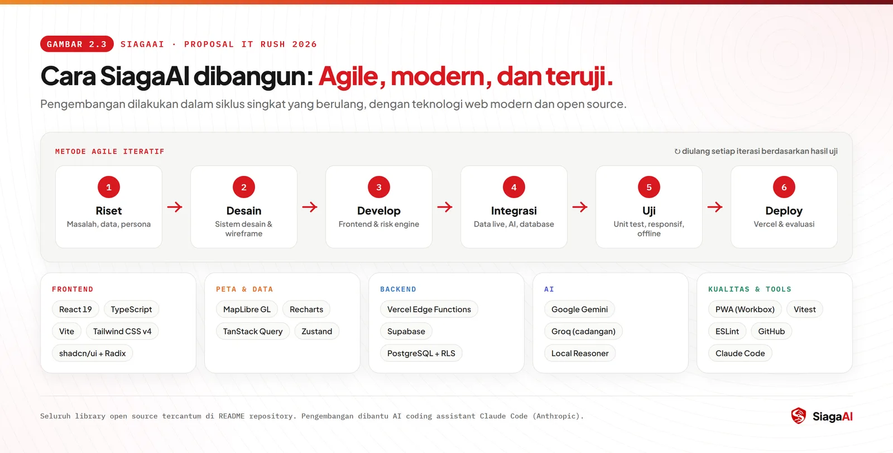

<div align="center">


# SiagaAI

### AI-Powered Personal Disaster Intelligence for Indonesia

**Know the Risk. Understand the Impact. Take Action.**

[🇮🇩 Bahasa Indonesia](README.md) · **🇬🇧 English**

IT RUSH 2026 · Web Development · Sub-theme **Disaster Mitigation and Climate Change**


**[🌐 Live demo](https://ISI-URL-VERCEL.vercel.app)** · **[🎬 60-second tour](#-try-it-in-60-seconds)** · **[📐 Methodology](docs/METHODOLOGY.md)** · **[🏗️ Architecture](docs/ARCHITECTURE.md)**

</div>

> Figures in this README come from the competition proposal and are labelled in Indonesian. The app itself is fully bilingual (ID/EN).

---

## Overview

**SiagaAI** is a Progressive Web App that turns Indonesia's official hazard data (BMKG, NASA FIRMS, Copernicus CAMS & GloFAS) into **personal risk that is easy to understand and concrete steps people can take right away**, based on each user's location, occupation, transport, and family.

> Typical information systems answer *"What is happening?"*. SiagaAI goes on to answer *"What does it mean for me?"* and *"What should I do now?"*.

Core principle: **Algorithm calculates. AI communicates.** Risk scores come from a transparent, deterministic, unit-tested algorithm; AI only explains them and drafts action plans, and **never makes up numbers**.

## Table of contents

1. [Problem](#-problem) · 2. [Solution](#-solution) · 3. [What sets it apart](#-what-sets-it-apart) · 4. [Features](#-features) · 5. [Screens](#-screens) · 6. [Try it in 60 seconds](#-try-it-in-60-seconds)
7. [Architecture](#-architecture) · 8. [Siaga Risk Engine](#-siaga-risk-engine) · 9. [AI integration](#-ai-integration) · 10. [Tech stack](#-tech-stack) · 11. [Data sources](#-data-sources)
12. [Run locally](#-run-locally) · 13. [Deployment](#-deployment) · 14. [Repository layout](#-repository-layout) · 15. [Quality & testing](#-quality--testing)
16. [Privacy & security](#-privacy--security) · 17. [Limitations](#-limitations) · 18. [Impact & SDGs](#-impact--sdgs) · 19. [Credits](#-credits--ai-disclosure) · 20. [Team](#-team)

---

## 🚨 Problem

In 2025 Indonesia recorded **3,233 disaster events**, close to **9 per day**, and **99%** of them were hydrometeorological (floods, extreme weather, forest and land fires) — hazards that **can be forecast in advance**.



The problem is **not a lack of data** but data that does not speak to people. Hazard information is:

- **scattered** across many portals and formats;
- **technical**: raw numbers such as *"PM2.5 182 µg/m³"* or *"24 hotspots"* with no meaning attached;
- **generic**: one warning per province, the same for everyone.

The result: **early warnings exist, but early action does not happen**.



## 💡 Solution

SiagaAI is a **personal risk translator**. Four stages remove the barriers between information and action, one by one.



| Stage | Question | Implementation |
|---|---|---|
| **01 Detect** | What is happening? | Live data from BMKG (forecasts, early warnings, earthquakes), NASA FIRMS, CAMS, GloFAS |
| **02 Understand** | What does the data mean? | **Siaga Risk Engine**: a 0–100 score per hazard, deterministic and tested |
| **03 Personalize** | What does it mean for me? | Exposure modifiers from occupation, transport, activity, and family age groups |
| **04 Act** | What should I do? | AI writes the brief, personal impact, three-phase action plan, family plan, and answers questions |

## 🏆 What sets it apart



1. **Personal risk**: the score adapts to occupation, transport, and family members.
2. **Many hazards, one score**: wildfire, smoke, flood, and extreme weather assessed together.
3. **Straight to action**: a *Now / Next few hours / If it gets worse* checklist.
4. **Honest AI**: the algorithm calculates, AI explains, and the source of every number is shown.
5. **Accessible**: no login required, installable (PWA), useful offline, bilingual (ID/EN), dark/light mode.

## ✨ Features

| Feature | Description |
|---|---|
| 🏠 **Siaga Dashboard** | Answers *"How safe is your location today?"* in 5 seconds: personal/location Siaga Score with trend, 4 hazard cards, nearby map, **SiagaAI Brief**, 24-hour weather chart, safe outdoor hours, PM2.5, official warnings, and a data-freshness panel |
| 📍 **Smart location** | GPS (only with permission, never stored), city/regency search, saved places, and high-risk region shortcuts |
| 🗺️ **Siaga Map** | WebGL map with 8 layers: hotspot clusters, heatmap, activity by province, BMKG warnings, city weather, PM2.5, earthquakes, community reports |
| 🧭 **Regional summary** | Click a province: 24 h / 7 day hotspots, trend, daily chart, capital-city weather, risk score, BMKG warnings, and **Explain with AI** |
| ✨ **My Risk** | *"What does it mean for me?"*: change your profile and watch the score change, per-indicator contributions, safe-hours index, a 4-persona comparison, and an AI personal impact analysis |
| 🔔 **Alert Center** | BMKG early warnings, BMKG earthquakes, and SiagaAI indicative signals in 4 levels. Earthquake levels account for **distance and age** relative to the user |
| 📋 **AI Action Plan** | A three-phase plan you can tick off, share, print, keep, and open offline, plus an **emergency go-bag** checklist and tap-to-call emergency numbers (112, 117, 113, 115, 119, 110, 123) |
| 👨‍👩‍👧 **Family Siaga** | Risk per family member (toddlers, children, older adults, high exposure), priority status, and a family action plan |
| 💬 **Ask Ara** | A contextual AI assistant (knows your location, score, weather, profile) with suggested questions and follow-ups |
| 📣 **Community Reports** | Incident reports with compressed, EXIF-stripped photos and optional GPS, **always labelled "Unverified"**, realtime via Supabase |
| 📚 **Data & Methodology** | Data sources, weights (rendered straight from the engine code), the role of AI, privacy, and limitations |
| 📶 **Offline-first PWA** | Installable, app shell & basemap cached, stale data always labelled, local notifications for important alerts |

The mascot **Ara**, a preparedness volunteer, guides users on every page and is the primary persona: a motorcycle-riding student in Palangka Raya who lives with her grandmother and younger brother.

## 📱 Screens





## ⏱️ Try it in 60 seconds

> **Live:** `https://ISI-URL-VERCEL.vercel.app` · **No login needed**; every core feature works as a guest.
> Demo account (optional): `demo@siagaai.id` / `SiagaAI2026!`. Switch the language to **EN** in the top bar.



1. On the landing page, click **Check My Location** (or **Explore Siaga Map**).
2. On the **Dashboard**, review the Siaga Score, hazard cards, nearby map, and **SiagaAI Brief**.
3. In the *Explore* card, pick another high-risk region such as **Palangka Raya** or **Pekanbaru**.
4. Open **My Risk** → **Analyse personal impact**. Switch transport to *Car* and watch the score change.
5. Open **Action Plan** → create your plan, then tick a few steps.
6. Open **Siaga Map**, click a province, then **Explain with AI**.
7. Click **Ask Ara** and try *"I'm riding a motorcycle to campus at 8 tomorrow. How does it look?"*.

A small label under every AI answer shows which provider produced it (**Google Gemini**, **Groq**, or the *Local Reasoner* when offline).

## 🏗️ Architecture



- The **frontend (React PWA)** reads CORS-enabled public data straight from the source and computes risk **on the user's device**.
- The **serverless API (Vercel Edge)** handles sources without CORS and every secret. Its logic lives once in `backend/core/` and runs on Vercel Edge, Supabase Edge (Deno), and the Vite dev server.
- **Supabase (optional)** adds accounts, cross-device sync, report photos, and realtime. Without it, data stays safely on the device.

| Endpoint | Purpose |
|---|---|
| `POST /api/ai` | LLM gateway: validation, rate limiting, structured prompts, provider & model fallback chain, JSON schema validation |
| `GET /api/hotspots?range=7d\|24h` | NASA FIRMS proxy (CSV → compact JSON, de-duplicated, 30-minute CDN cache) |
| `GET /api/alerts` | BMKG Nowcast proxy (RSS → JSON, 10-minute cache) |
| `GET /api/health` | Integration status (no secrets exposed) |

**Graceful degradation:** every source has a fallback. BMKG fails → Open-Meteo; FIRMS fails → labelled snapshot; LLM fails → *Local Reasoner*; offline → labelled cached data. Details in [`docs/ARCHITECTURE.md`](docs/ARCHITECTURE.md) (Indonesian).

## 📐 Siaga Risk Engine

Code: [`frontend/src/features/risk/engine/`](frontend/src/features/risk/engine) · Full write-up: [`docs/METHODOLOGY.md`](docs/METHODOLOGY.md) (Indonesian)

1. **Hazard score (0–100)** = Σ (normalised indicator × weight):

   | Hazard | Indicators (weight) |
   |---|---|
   | 🔥 Wildfire | Hotspot proximity & density 30% · Recency 20% · Dryness 15% · Wind 15% · PM2.5 20% |
   | 💨 Smoke | PM2.5 50% · Upwind hotspots 30% · Visibility 20% |
   | 🌊 Flood | 24 h rainfall 35% · Peak intensity 25% · GloFAS discharge anomaly 20% · BMKG warning 20% |
   | ⛈️ Extreme weather | Thunderstorms 35% · Wind gusts 25% · Rain probability 20% · Heat 20% |

2. **Missing data ≠ zero.** Its weight is redistributed proportionally and confidence is lowered; below 40% coverage the hazard is not scored.
3. **Location score** = 85% dominant hazard + 15% second hazard.
4. **Personal score** = hazard score × exposure modifier (clamped to **0.8–1.3**), per hazard.
5. **Categories**: 0–20 Safe · 21–40 Low · 41–60 Moderate · 61–80 High · 81–100 Critical, always shown as **colour + icon + text**.
6. Presented as an **Indicative Siaga Score**: a decision aid, **not an official warning**.

## 🤖 AI integration

Full design in [`ai/README.md`](ai/README.md) (Indonesian).

- **Tasks**: SiagaAI Brief, personal impact, action plan, family plan, regional explanation, and the Ask Ara assistant.
- **Secure path**: PWA → `/api/ai` → LLM. API keys live only on the server.
- **Provider chain**: **Google Gemini** (primary) → **Groq** → OpenRouter → **Local Reasoner** (deterministic, runs in the browser and offline). Each provider has several candidate models, so retired or overloaded models are skipped automatically. All attempts share a 22-second deadline with time reserved for fallback providers.
- **Guardrails**: request validation, 32 KB payload limit, per-IP rate limiting, schema-validated JSON output, output sanitising, and a system prompt that forbids inventing numbers or calling hotspots "fires".
- **Privacy-minimal context**: only structured data is sent; coordinates are rounded to ±1 km, with no names, emails, or medical data.
- **Grounding**: recommendations are anchored in a preparedness action library based on BNPB, BMKG, and Ministry of Health guidance.

## 🧰 Tech stack



| Layer | Technology |
|---|---|
| Frontend | React 19, Vite 7, TypeScript 5.9 (strict), React Router 7 |
| UI | Tailwind CSS v4, shadcn/ui component patterns on Radix UI, Lucide, Plus Jakarta Sans & IBM Plex Mono |
| Maps & charts | MapLibre GL JS (WebGL), Recharts |
| State & forms | TanStack Query (cache, retry, offline), Zustand (persist), React Hook Form + Zod |
| Backend | Vercel Edge Functions (alternative: Supabase Edge Functions) |
| Database & Auth | Supabase: PostgreSQL + Row Level Security, Auth, Storage, Realtime |
| AI | Google Gemini, Groq, OpenRouter, SiagaAI Local Reasoner |
| PWA | vite-plugin-pwa (Workbox) |
| Quality | ESLint (typescript-eslint), Prettier, Vitest |

## 🛰️ Data sources

| Source | Data | Access |
|---|---|---|
| **BMKG** Weather Forecast (adm4) | Temperature, humidity, wind, conditions every 3 h | Direct |
| **BMKG** Early Weather Warnings (Nowcast) | Warnings per province + validity | `/api/alerts` |
| **BMKG** Earthquake Information (TEWS) | Latest & M5+ earthquakes | Direct |
| **NASA FIRMS** VIIRS NRT (NOAA-20/21, S-NPP) | 7-day hotspots, confidence, FRP | `/api/hotspots` (+ labelled snapshot) |
| **Open-Meteo** Forecast | Hourly rain & probability, gusts, visibility | Direct |
| **Copernicus CAMS** via Open-Meteo | PM2.5, PM10, US AQI (model) | Direct |
| **Copernicus GloFAS** via Open-Meteo | 30-day river discharge + 7-day forecast | Direct |
| Province boundaries (ans-4175, MIT) | 34 provinces, simplified | Static |

The app shows the **"Source: BMKG"** attribution required by BMKG.

## 💻 Run locally

Requirement: **Node.js ≥ 20**.

```bash
git clone https://github.com/StyNW7/SiagaAI.git
cd SiagaAI/frontend
npm install
npm run dev        # http://localhost:5173 (frontend + /api through the Vite bridge)
```

**The app is fully functional without any API key**: AI uses the Local Reasoner, hotspots use the public FIRMS feed, and accounts use device mode. To enable the LLMs, copy `.env.example` to `.env` at the **repository root**:

| Variable | Where | Notes |
|---|---|---|
| `GEMINI_API_KEY`, `GEMINI_MODEL` | Server | Primary LLM. Free key: [Google AI Studio](https://aistudio.google.com/apikey) |
| `GROQ_API_KEY`, `GROQ_MODEL` | Server | Fast fallback. Free key: [console.groq.com](https://console.groq.com/keys) |
| `OPENROUTER_API_KEY`, `OPENROUTER_MODEL` | Server | Second fallback (optional) |
| `FIRMS_MAP_KEY` | Server | Optional: NASA FIRMS Area API (public feed is used without it) |
| `VITE_SUPABASE_URL`, `VITE_SUPABASE_ANON_KEY` | Client | Optional: auth, sync, realtime (the anon key is public by design, protected by RLS) |
| `VITE_AI_ENDPOINT` | Client | Optional: point AI at a Supabase Edge Function |

`*_MODEL` may be left empty; the gateway ships with default and fallback models. **Never commit `.env`.**

## 🚀 Deployment

**Vercel** (free, recommended):

1. Import the repository with **Root Directory = repo root**. `vercel.json` already sets install, build, output, SPA rewrites, security headers, and the Edge Functions in `api/`.
2. Add environment variables under *Settings → Environment Variables* (at least `GEMINI_API_KEY` and `GROQ_API_KEY`), then **Redeploy**.
3. Open `/api/health` and check that `"ai"` lists the active providers.

**Supabase** (optional):

```bash
cd backend
supabase link --project-ref <ref>
supabase db push                              # schema + RLS + storage + realtime
supabase functions deploy siaga-ai hotspots   # alternative gateway (optional)
```

Run `backend/supabase/seed.sql` once in the SQL Editor to create the demo account, then set `VITE_SUPABASE_URL` and `VITE_SUPABASE_ANON_KEY` on Vercel.

## 🗂️ Repository layout

```text
.
├── frontend/              # React PWA
│   ├── public/            # brand, PWA icons, Ara mascot, province boundaries, FIRMS snapshot
│   └── src/
│       ├── app/           # router, error boundary
│       ├── components/    # ui/ (shadcn patterns), common/ (brand, risk, data-state, Ara)
│       ├── features/      # risk/engine (+ tests), map, ai, alerts, community, story, pwa, …
│       ├── pages/         # landing, dashboard, map, risk, alerts, action plan, family, …
│       ├── services/      # weather, hazards, geo, ai (client, context, local reasoner), supabase
│       ├── hooks/ stores/ data/ lib/ types/
├── api/                   # Vercel Edge Functions (thin wrappers around backend/core)
├── backend/
│   ├── core/              # runtime-agnostic handlers: ai-gateway, hotspots, alerts (+ tests)
│   └── supabase/          # migrations (schema + RLS), Edge Functions, seed
├── ai/                    # AI contracts (schemas, validators), prompt library, AI design
├── docs/                  # ARCHITECTURE.md, METHODOLOGY.md
├── images/                # logo & README figures
└── vercel.json
```

## ✅ Quality & testing

```bash
cd frontend
npm run test        # 31 Vitest tests
npm run lint        # ESLint
npm run typecheck   # strict TypeScript
npm run build       # typecheck + production build + service worker
```

Automated tests cover score curves and categories, weight redistribution, wildfire/flood scenarios, exposure-modifier bounds, hotspot proximity and wind direction, province matching, safe time windows, the BMKG RSS and FIRMS CSV parsers, FIRMS Area API windows, distance-aware earthquake levels, AI request/schema validation, JSON extraction, and rate limiting.

Manual testing: every page at 360–1440 px with no horizontal overflow, dark/light mode, ID/EN, every data state (loading, success, error, snapshot, offline), and accessibility (skip link, visible focus, ARIA, risk = colour + icon + text). All four Edge Functions were verified with the `@vercel/node` builder.

## 🔒 Privacy & security

- GPS is read only after permission and **never stored** unless the user chooses *Save location*.
- Score history and reports keep rounded coordinates (±1 km). No medical data; family profiles hold only age group and exposure.
- Report photos are compressed and stripped of EXIF/GPS on the device; report text is sanitised.
- Supabase uses **Row Level Security** on every user-owned table, uploads are limited to the owner's folder, and report confirmation goes through a `SECURITY DEFINER` function.
- API keys stay on the server; security headers (`X-Content-Type-Options`, `Referrer-Policy`, `Permissions-Policy`, `X-Frame-Options`) are set in `vercel.json`.

## ⚠️ Limitations

- Hotspots are **satellite thermal detections**, not confirmed fires.
- PM2.5 comes from the CAMS **model** (±40 km resolution), not local sensors; GloFAS is ±5 km and does not model urban drainage or tidal flooding.
- The map uses 34 province boundaries (before the 2022 Papua split); new provinces map to their parent province.
- Weights and thresholds are **documented heuristics** not yet calibrated against historical events.
- Gateway rate limiting is per instance; production scale needs a shared store.

## 🌏 Impact & SDGs

| SDG | Contribution |
|---|---|
| **13.1** Climate Action | Resilience and adaptive capacity against wildfires, floods, and extreme weather |
| **11.5** Sustainable Cities | Reducing disaster impact through personal early action |
| **3.9 & 3.d** Good Health | Less exposure to smoke/pollution and stronger early warning for health risks |
| **15** Life on Land | Hotspot monitoring and early wildfire reporting |

Aligned with the **Sendai Framework** (Priorities 1 & 4) and the UN **Early Warnings for All** initiative.

## 📜 Credits & AI disclosure

**Open source:** React, React Router, Vite, TypeScript, Tailwind CSS, Radix UI, shadcn/ui (component patterns), Lucide, MapLibre GL JS, Recharts, TanStack Query, Zustand, React Hook Form, Zod, Sonner, vite-plugin-pwa/Workbox, Supabase JS, Fontsource, class-variance-authority, clsx, tailwind-merge, sharp, Vitest, ESLint, Prettier.

**Data:** BMKG, NASA FIRMS, Open-Meteo (CC BY 4.0) with Copernicus CAMS & GloFAS, © OpenStreetMap contributors, OpenFreeMap/CARTO, ans-4175/peta-indonesia-geojson (MIT), Nominatim, BigDataCloud. 2025 disaster statistics: BNPB.

**AI disclosure:** as required by IT RUSH 2026, development of this repository was assisted by the AI coding assistant **Claude Code (Anthropic)** for code, documentation, and testing. All product decisions, reviews, and testing are the team's responsibility. Inside the product, AI (Gemini/Groq) only explains the algorithm's results.

## 👤 Team

**Mapres SUNIB vs Everyone**

| Role | Name | Institution |
|---|---|---|
| Lead (solo team) | Stanley Nathanael Wijaya | BINUS University |

---

<div align="center">
<sub>SiagaAI is a decision-support platform and <b>does not replace official warnings or instructions</b> from BMKG, BNPB, BPBD, and the authorities. In an emergency, call <b>112</b>.</sub>
</div>
