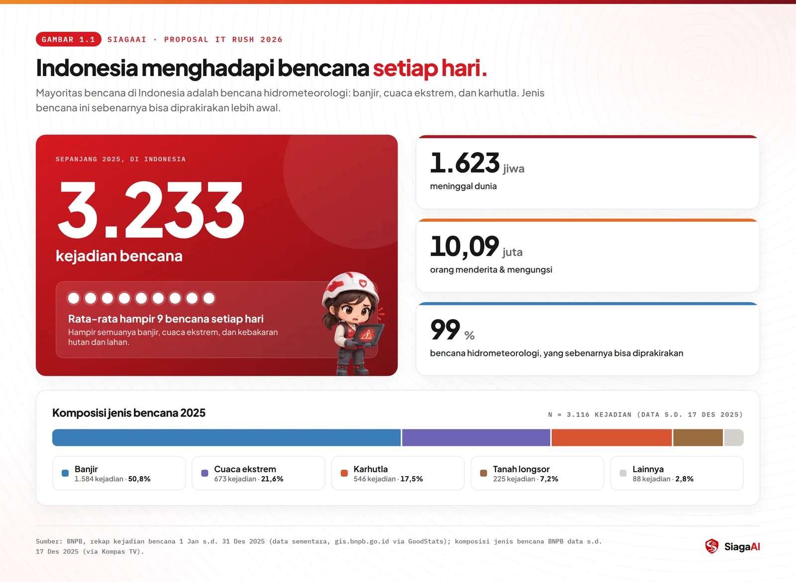
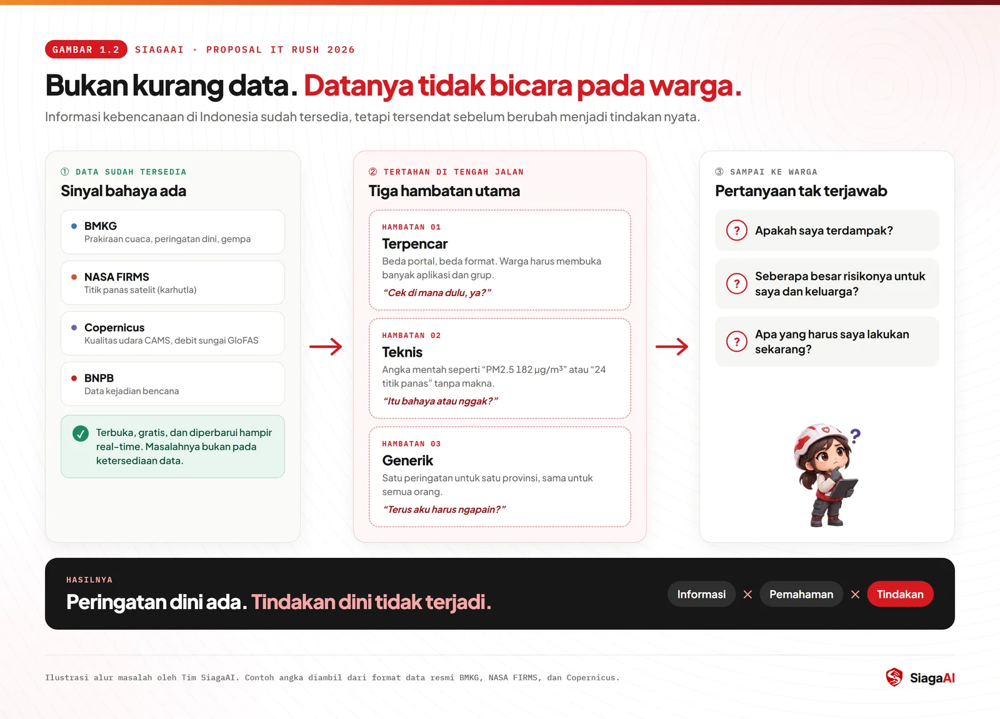
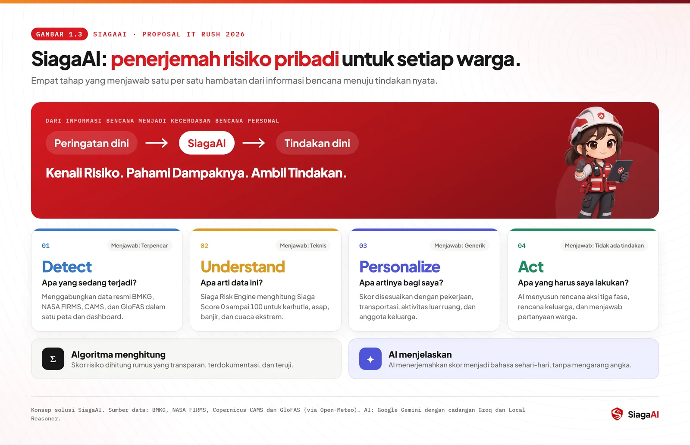
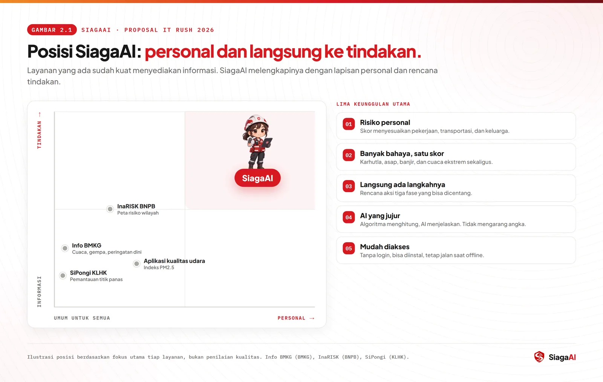
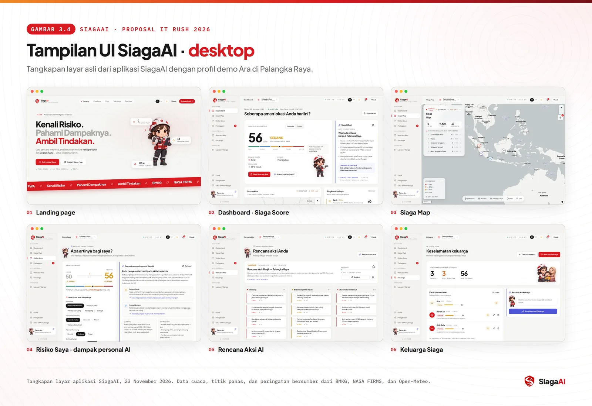
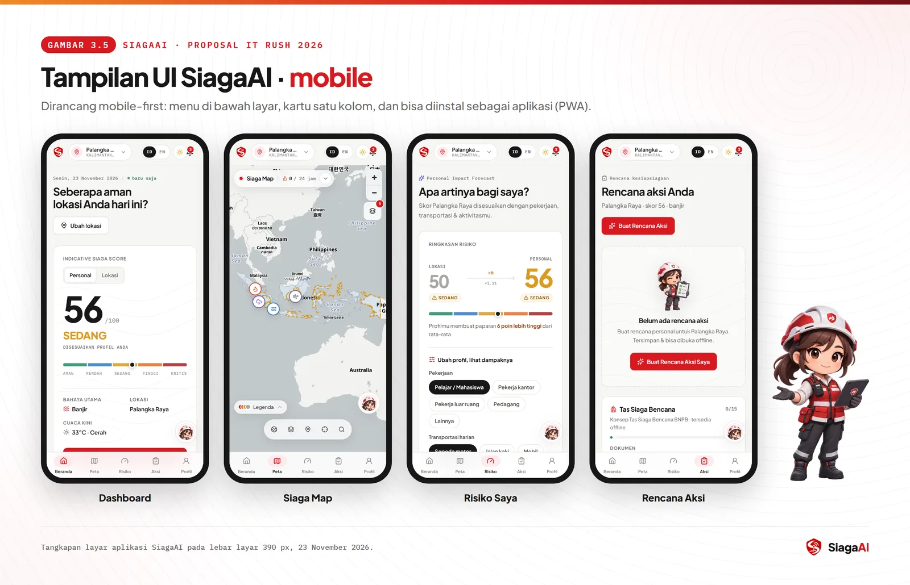
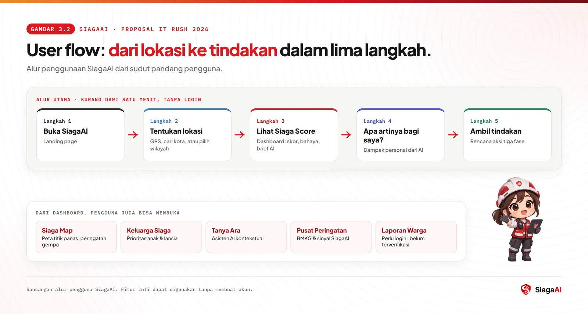
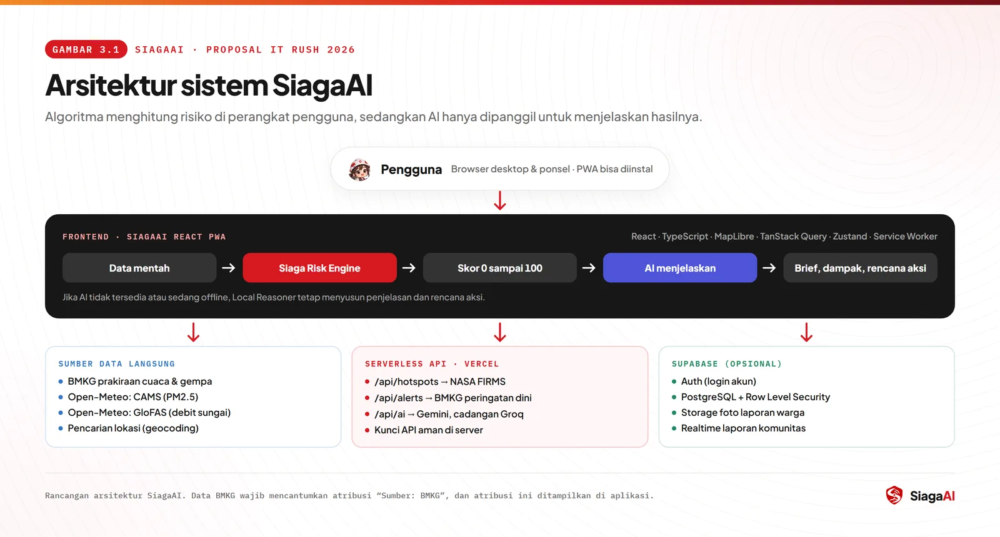
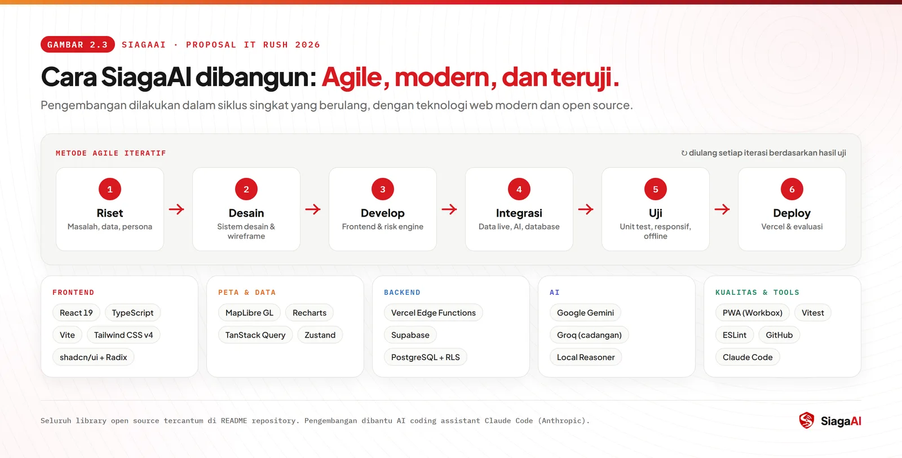

<div align="center">


# SiagaAI

### Kecerdasan Kebencanaan Personal Berbasis AI untuk Indonesia

**Kenali Risiko. Pahami Dampaknya. Ambil Tindakan.**

**🇮🇩 Bahasa Indonesia** · [🇬🇧 English](README.en.md)

IT RUSH 2026 · Web Development · Subtema **Mitigasi Bencana dan Perubahan Iklim**


**[🌐 Demo live](https://siaga-ai-rush.vercel.app)** · **[🎬 Panduan demo](#-panduan-demo)** · **[📐 Metodologi](docs/METHODOLOGY.md)** · **[🏗️ Arsitektur](docs/ARCHITECTURE.md)**

</div>

---

## Ringkasan

**SiagaAI** adalah *Progressive Web App* yang mengubah data kebencanaan resmi Indonesia (BMKG, NASA FIRMS, Copernicus CAMS & GloFAS) menjadi **risiko personal yang mudah dipahami dan langkah nyata yang bisa langsung dilakukan**, sesuai lokasi, pekerjaan, transportasi, dan keluarga setiap pengguna.

> Sistem informasi biasa menjawab *"Apa yang terjadi?"*. SiagaAI menjawab sampai *"Apa artinya bagi saya?"* dan *"Apa yang harus saya lakukan sekarang?"*.

**Coba langsung:** [siaga-ai-rush.vercel.app](https://siaga-ai-rush.vercel.app) (tanpa login, bisa diinstal sebagai aplikasi)

Prinsip inti: **Algorithm calculates. AI communicates.** Skor risiko dihitung oleh algoritma deterministik yang transparan dan teruji; AI hanya menjelaskan dan menyusun rencana aksi, **tidak pernah mengarang angka**.

## Daftar isi

1. [Masalah](#-masalah) · 2. [Solusi](#-solusi) · 3. [Keunggulan](#-keunggulan) · 4. [Fitur](#-fitur) · 5. [Tampilan](#-tampilan) · 6. [Panduan demo](#-panduan-demo)
7. [Arsitektur](#-arsitektur) · 8. [Siaga Risk Engine](#-siaga-risk-engine) · 9. [Integrasi AI](#-integrasi-ai) · 10. [Teknologi](#-teknologi) · 11. [Sumber data](#-sumber-data)
12. [Menjalankan lokal](#-menjalankan-lokal) · 13. [Deployment](#-deployment) · 14. [Struktur repository](#-struktur-repository) · 15. [Kualitas & pengujian](#-kualitas--pengujian)
16. [Privasi & keamanan](#-privasi--keamanan) · 17. [Keterbatasan](#-keterbatasan) · 18. [Dampak & SDGs](#-dampak--sdgs) · 19. [Atribusi](#-atribusi--pengungkapan-ai) · 20. [Tim](#-tim)

---

## 🚨 Masalah

Sepanjang 2025, Indonesia mencatat **3.233 kejadian bencana**, rata-rata hampir **9 per hari**, dan **99%** di antaranya bencana hidrometeorologi (banjir, cuaca ekstrem, karhutla) yang sebenarnya **bisa diprakirakan lebih awal**.



Masalahnya **bukan kekurangan data**, melainkan data yang tidak "bicara" pada warga. Informasi bencana:

- **terpencar** di banyak portal dan format berbeda;
- **teknis**: angka mentah seperti *"PM2.5 182 µg/m³"* atau *"24 titik panas"* tanpa makna;
- **generik**: satu peringatan untuk satu provinsi, sama untuk semua orang.

Akibatnya, **peringatan dini ada, tetapi tindakan dini tidak terjadi**.



## 💡 Solusi

SiagaAI adalah **penerjemah risiko pribadi**. Empat tahap menjawab satu per satu hambatan dari informasi menuju tindakan.



| Tahap | Pertanyaan | Implementasi |
|---|---|---|
| **01 Detect** | Apa yang sedang terjadi? | Agregasi data live BMKG (prakiraan, peringatan dini, gempa), NASA FIRMS, CAMS, GloFAS |
| **02 Understand** | Apa arti data ini? | **Siaga Risk Engine**: skor 0–100 per bahaya, deterministik dan teruji |
| **03 Personalize** | Apa artinya bagi saya? | Pengubah paparan dari pekerjaan, transportasi, aktivitas, dan kelompok usia keluarga |
| **04 Act** | Apa yang harus saya lakukan? | AI menyusun brief, dampak personal, rencana aksi tiga fase, rencana keluarga, dan menjawab pertanyaan |

## 🏆 Keunggulan



1. **Risiko personal**: skor berubah sesuai pekerjaan, transportasi, dan anggota keluarga.
2. **Banyak bahaya, satu skor**: karhutla, asap, banjir, dan cuaca ekstrem dinilai sekaligus.
3. **Langsung ada langkahnya**: rencana aksi *Sekarang / Beberapa jam ke depan / Jika memburuk* yang bisa dicentang.
4. **AI yang jujur**: algoritma menghitung, AI menjelaskan, dan sumber setiap angka selalu ditampilkan.
5. **Mudah diakses**: tanpa login, bisa diinstal (PWA), tetap berguna saat offline, dua bahasa (ID/EN), mode gelap/terang.

## ✨ Fitur

| Fitur | Keterangan |
|---|---|
| 🏠 **Siaga Dashboard** | Menjawab *"Seberapa aman lokasi Anda hari ini?"* dalam 5 detik: Siaga Score personal/lokasi + tren, 4 kartu bahaya, peta sekitar, **SiagaAI Brief**, grafik cuaca 24 jam, jam aman beraktivitas, PM2.5, peringatan resmi, dan panel kesegaran data |
| 📍 **Lokasi cerdas** | GPS (hanya dengan izin, tidak disimpan), pencarian kota/kabupaten, lokasi tersimpan, dan pintasan wilayah rawan |
| 🗺️ **Siaga Map** | Peta WebGL dengan 8 lapisan: kluster titik panas, heatmap, aktivitas per provinsi, peringatan BMKG, cuaca kota, PM2.5, gempa, laporan warga |
| 🧭 **Ringkasan regional** | Klik provinsi: titik panas 24 jam/7 hari, tren, grafik harian, cuaca ibu kota, skor risiko, peringatan BMKG, dan **Jelaskan dengan AI** |
| ✨ **Risiko Saya** | *"Apa artinya bagi saya?"*: ubah profil dan lihat skor berubah, rincian kontribusi setiap indikator, indeks jam aman, perbandingan 4 persona, dan analisis dampak personal AI |
| 🔔 **Pusat Peringatan** | Peringatan dini BMKG, gempa BMKG, dan sinyal indikatif SiagaAI dalam 4 level. Level gempa disesuaikan dengan **jarak dan usia kejadian** dari lokasi pengguna |
| 📋 **Rencana Aksi AI** | Rencana tiga fase yang bisa dicentang, dibagikan, dicetak, tersimpan, dan tersedia offline, plus **Tas Siaga Bencana** dan nomor darurat (112, 117, 113, 115, 119, 110, 123) yang bisa langsung ditelepon |
| 👨‍👩‍👧 **Keluarga Siaga** | Risiko per anggota keluarga (balita, anak, lansia, paparan tinggi), status prioritas, dan rencana aksi keluarga |
| 💬 **Tanya Ara** | Asisten AI kontekstual (paham lokasi, skor, cuaca, profil) dengan pertanyaan saran dan *follow-up* |
| 📣 **Laporan Warga** | Laporan kejadian dengan foto terkompresi tanpa EXIF dan GPS opsional, **selalu berlabel "Belum terverifikasi"**, realtime lewat Supabase |
| 📚 **Data & Metodologi** | Sumber data, bobot (dirender langsung dari kode engine), peran AI, privasi, dan batasan |
| 📶 **PWA offline-first** | Bisa diinstal, app shell & basemap di-cache, data lama selalu berlabel, notifikasi lokal untuk peringatan penting |

Maskot **Ara**, relawan siaga, memandu pengguna di setiap halaman dan menjadi persona utama: mahasiswi bermotor di Palangka Raya yang tinggal bersama nenek dan adiknya.

## 📱 Tampilan





## 🎬 Panduan demo

> **Live:** [siaga-ai-rush.vercel.app](https://siaga-ai-rush.vercel.app) · **Login tidak wajib**; semua fitur inti berjalan dalam mode tamu.
> Akun demo (opsional, untuk mencoba sinkronisasi & Laporan Warga): `demo@siagaai.id` / `SiagaAI2026!`



1. Di beranda, klik **Cek Lokasi Saya** (atau **Jelajahi Siaga Map**).
2. Di **Dashboard**, lihat Siaga Score, kartu bahaya, peta sekitar, dan **SiagaAI Brief**.
3. Pada kartu *Eksplorasi*, pilih wilayah rawan lain, misalnya **Palangka Raya** atau **Pekanbaru**.
4. Buka **Risiko Saya** → **Analisis dampak personal**. Ganti transportasi menjadi *Mobil* dan lihat skornya berubah.
5. Buka **Rencana Aksi** → **Buat Rencana Aksi Saya**, lalu centang beberapa langkah.
6. Buka **Siaga Map**, klik provinsi, lalu **Jelaskan dengan AI**.
7. Klik **Tanya Ara** dan coba *"Saya naik motor ke kampus jam 8 besok. Bagaimana?"*.

Label kecil di bawah setiap jawaban AI menunjukkan penyedianya (**Google Gemini**, **Groq**, atau *Local Reasoner* saat offline).

## 🏗️ Arsitektur



- **Frontend (React PWA)** mengambil data publik yang mendukung CORS langsung dari sumbernya, lalu menghitung risiko **di perangkat pengguna**.
- **Serverless API (Vercel Edge)** menangani sumber yang tidak mendukung CORS dan semua rahasia. Logikanya ditulis sekali di `backend/core/` dan dijalankan di Vercel Edge, Supabase Edge (Deno), maupun dev server Vite.
- **Supabase (opsional)** untuk akun, sinkronisasi antarperangkat, foto laporan, dan realtime. Tanpa Supabase, data tersimpan aman di perangkat.

| Endpoint | Fungsi |
|---|---|
| `POST /api/ai` | Gateway LLM: validasi, rate limit, prompt terstruktur, rantai penyedia & model cadangan, validasi skema JSON |
| `GET /api/hotspots?range=7d\|24h` | Proxy NASA FIRMS (CSV → JSON ringkas, deduplikasi, cache CDN 30 menit) |
| `GET /api/alerts` | Proxy BMKG Nowcast (RSS → JSON, cache 10 menit) |
| `GET /api/health` | Status integrasi (tanpa membuka rahasia) |

**Ketahanan (graceful degradation):** setiap sumber punya cadangan. BMKG gagal → Open-Meteo; FIRMS gagal → snapshot berlabel; LLM gagal → *Local Reasoner*; offline → data cache berlabel. Detail ada di [`docs/ARCHITECTURE.md`](docs/ARCHITECTURE.md).

## 📐 Siaga Risk Engine

Kode: [`frontend/src/features/risk/engine/`](frontend/src/features/risk/engine) · Rincian lengkap: [`docs/METHODOLOGY.md`](docs/METHODOLOGY.md)

1. **Skor per bahaya (0–100)** = Σ (indikator ternormalisasi × bobot):

   | Bahaya | Indikator (bobot) |
   |---|---|
   | 🔥 Karhutla | Kedekatan & kepadatan titik panas 30% · Kebaruan 20% · Kekeringan 15% · Angin 15% · PM2.5 20% |
   | 💨 Asap | PM2.5 50% · Titik panas searah angin 30% · Jarak pandang 20% |
   | 🌊 Banjir | Hujan 24 jam 35% · Intensitas puncak 25% · Anomali debit GloFAS 20% · Peringatan BMKG 20% |
   | ⛈️ Cuaca ekstrem | Badai petir 35% · Hembusan angin 25% · Peluang hujan 20% · Panas 20% |

2. **Data tidak tersedia ≠ nol.** Bobotnya dialihkan proporsional dan tingkat keyakinan diturunkan; bila cakupan < 40%, bahaya tidak dinilai.
3. **Skor lokasi** = 85% bahaya dominan + 15% bahaya kedua.
4. **Skor personal** = skor bahaya × pengubah paparan (dibatasi **0,8–1,3**), dihitung per bahaya.
5. **Kategori**: 0–20 Aman · 21–40 Rendah · 41–60 Sedang · 61–80 Tinggi · 81–100 Kritis, selalu ditampilkan sebagai **warna + ikon + teks**.
6. Ditampilkan sebagai **Indicative Siaga Score**: alat bantu keputusan, **bukan peringatan resmi**.

## 🤖 Integrasi AI

Desain lengkap ada di [`ai/README.md`](ai/README.md).

- **Tugas**: SiagaAI Brief, dampak personal, rencana aksi, rencana keluarga, penjelasan regional, dan asisten Tanya Ara.
- **Alur aman**: PWA → `/api/ai` → LLM. Kunci API hanya ada di server.
- **Rantai penyedia**: **Google Gemini** (utama) → **Groq** → OpenRouter → **Local Reasoner** (deterministik, berjalan di browser & offline). Setiap penyedia punya beberapa kandidat model, sehingga model yang dipensiunkan atau sedang penuh otomatis dilewati. Semua percobaan berbagi tenggat 22 detik dengan jatah waktu khusus untuk penyedia cadangan.
- **Guardrails**: validasi request, batas payload 32 KB, rate limit per IP, output JSON yang divalidasi skema, sanitasi output, dan *system prompt* yang melarang mengarang angka atau menyebut titik panas sebagai "kebakaran".
- **Konteks minimal-privasi**: hanya data terstruktur yang dikirim; koordinat dibulatkan ±1 km, tanpa nama, email, atau data medis.
- **Grounding**: rekomendasi berlandaskan pustaka aksi kesiapsiagaan yang mengacu pada panduan BNPB, BMKG, dan Kemenkes.

## 🧰 Teknologi



| Layer | Teknologi |
|---|---|
| Frontend | React 19, Vite 7, TypeScript 5.9 (strict), React Router 7 |
| UI | Tailwind CSS v4, pola komponen shadcn/ui di atas Radix UI, Lucide, Plus Jakarta Sans & IBM Plex Mono |
| Peta & grafik | MapLibre GL JS (WebGL), Recharts |
| State & form | TanStack Query (cache, retry, offline), Zustand (persist), React Hook Form + Zod |
| Backend | Vercel Edge Functions (alternatif: Supabase Edge Functions) |
| Database & Auth | Supabase: PostgreSQL + Row Level Security, Auth, Storage, Realtime |
| AI | Google Gemini, Groq, OpenRouter, SiagaAI Local Reasoner |
| PWA | vite-plugin-pwa (Workbox) |
| Kualitas | ESLint (typescript-eslint), Prettier, Vitest |

## 🛰️ Sumber data

| Sumber | Data | Akses |
|---|---|---|
| **BMKG** Prakiraan Cuaca (adm4) | Suhu, kelembapan, angin, kondisi per 3 jam | Langsung |
| **BMKG** Peringatan Dini Cuaca (Nowcast) | Peringatan per provinsi + masa berlaku | `/api/alerts` |
| **BMKG** Informasi Gempabumi (TEWS) | Gempa terbaru & M5+ | Langsung |
| **NASA FIRMS** VIIRS NRT (NOAA-20/21, S-NPP) | Titik panas 7 hari, keyakinan, FRP | `/api/hotspots` (+ snapshot berlabel) |
| **Open-Meteo** Forecast | Hujan & peluang per jam, hembusan, jarak pandang | Langsung |
| **Copernicus CAMS** via Open-Meteo | PM2.5, PM10, US AQI (model) | Langsung |
| **Copernicus GloFAS** via Open-Meteo | Debit sungai 30 hari + prakiraan 7 hari | Langsung |
| Batas provinsi (ans-4175, MIT) | 34 provinsi, disederhanakan | Statis |

Atribusi **"Sumber: BMKG"** ditampilkan di aplikasi sesuai ketentuan BMKG.

## 💻 Menjalankan lokal

Prasyarat: **Node.js ≥ 20**.

```bash
git clone https://github.com/StyNW7/SiagaAI.git
cd SiagaAI/frontend
npm install
npm run dev        # http://localhost:5173 (frontend + /api lewat bridge Vite)
```

**Tanpa kunci API apa pun, aplikasi tetap berfungsi penuh**: AI memakai Local Reasoner, titik panas memakai feed publik FIRMS, dan akun memakai mode perangkat. Untuk mengaktifkan LLM, salin `.env.example` menjadi `.env` di **root repository**:

| Variabel | Lokasi | Keterangan |
|---|---|---|
| `GEMINI_API_KEY`, `GEMINI_MODEL` | Server | LLM utama. Kunci gratis: [Google AI Studio](https://aistudio.google.com/apikey) |
| `GROQ_API_KEY`, `GROQ_MODEL` | Server | Cadangan cepat. Kunci gratis: [console.groq.com](https://console.groq.com/keys) |
| `OPENROUTER_API_KEY`, `OPENROUTER_MODEL` | Server | Cadangan kedua (opsional) |
| `FIRMS_MAP_KEY` | Server | Opsional: NASA FIRMS Area API (tanpa ini memakai feed publik) |
| `VITE_SUPABASE_URL`, `VITE_SUPABASE_ANON_KEY` | Client | Opsional: Auth, sinkronisasi, realtime (anon key memang publik, dilindungi RLS) |
| `VITE_AI_ENDPOINT` | Client | Opsional: arahkan AI ke Supabase Edge Function |

`*_MODEL` boleh dikosongkan; gateway sudah punya daftar model default dan cadangan. **Jangan pernah commit `.env`.**

## 🚀 Deployment

Versi produksi berjalan di **Vercel**: [siaga-ai-rush.vercel.app](https://siaga-ai-rush.vercel.app) · status integrasi: [`/api/health`](https://siaga-ai-rush.vercel.app/api/health).

**Vercel** (gratis, direkomendasikan):

1. Import repository dengan **Root Directory = root repo**. `vercel.json` sudah mengatur install, build, output, rewrite SPA, header keamanan, dan Edge Functions di `api/`.
2. Isi variabel lingkungan di *Settings → Environment Variables* (minimal `GEMINI_API_KEY` dan `GROQ_API_KEY`), lalu **Redeploy**.
3. Buka `/api/health` dan pastikan `"ai"` berisi penyedia yang aktif.

**Supabase** (opsional):

```bash
cd backend
supabase link --project-ref <PROJECT_REF>   # ID proyek dari dashboard Supabase
supabase db push                              # schema + RLS + storage + realtime
supabase functions deploy siaga-ai hotspots   # gateway alternatif (opsional)
```

Jalankan `backend/supabase/seed.sql` sekali di SQL Editor untuk membuat akun demo, lalu isi `VITE_SUPABASE_URL` dan `VITE_SUPABASE_ANON_KEY` di Vercel.

## 🗂️ Struktur repository

```text
.
├── frontend/              # React PWA
│   ├── public/            # brand, ikon PWA, maskot Ara, batas provinsi, snapshot FIRMS
│   └── src/
│       ├── app/           # router, error boundary
│       ├── components/    # ui/ (pola shadcn), common/ (brand, risk, data-state, Ara)
│       ├── features/      # risk/engine (+ tes), map, ai, alerts, community, story, pwa, …
│       ├── pages/         # landing, dashboard, map, risk, alerts, action plan, family, …
│       ├── services/      # weather, hazards, geo, ai (client, context, local reasoner), supabase
│       ├── hooks/ stores/ data/ lib/ types/
├── api/                   # Vercel Edge Functions (pembungkus tipis backend/core)
├── backend/
│   ├── core/              # handler runtime-agnostic: ai-gateway, hotspots, alerts (+ tes)
│   └── supabase/          # migrations (schema + RLS), Edge Functions, seed
├── ai/                    # kontrak AI (skema, validator), pustaka prompt, desain AI
├── docs/                  # ARCHITECTURE.md, METHODOLOGY.md
├── images/                # logo & gambar README
└── vercel.json
```

## ✅ Kualitas & pengujian

```bash
cd frontend
npm run test        # 31 tes Vitest
npm run lint        # ESLint
npm run typecheck   # TypeScript strict
npm run build       # typecheck + build produksi + service worker
```

Cakupan tes otomatis: kurva & kategori skor, redistribusi bobot, skenario karhutla/banjir, batas pengubah paparan, kedekatan & arah angin titik panas, pencocokan provinsi, jendela waktu aman, parser RSS BMKG & CSV FIRMS, jendela Area API FIRMS, level gempa berbasis jarak, validasi request/skema AI, ekstraksi JSON, dan rate limit.

Pengujian manual: semua halaman pada lebar 360–1440 px tanpa *overflow* horizontal, mode gelap/terang, ID/EN, semua state data (loading, sukses, error, snapshot, offline), dan aksesibilitas (*skip link*, fokus terlihat, ARIA, risiko = warna + ikon + teks). Keempat Edge Function diverifikasi lewat builder `@vercel/node`.

## 🔒 Privasi & keamanan

- GPS hanya diakses setelah izin dan **tidak disimpan** kecuali pengguna memilih *Simpan lokasi*.
- Riwayat skor dan laporan menyimpan koordinat yang dibulatkan (±1 km). Tidak ada data medis; profil keluarga hanya berisi kelompok usia dan paparan.
- Foto laporan dikompres dan metadata EXIF/GPS dihapus di perangkat; teks laporan disanitasi.
- Supabase memakai **Row Level Security** di semua tabel milik pengguna, unggahan dibatasi ke folder pemilik, konfirmasi laporan lewat fungsi `SECURITY DEFINER`.
- Kunci API hanya di server; header keamanan (`X-Content-Type-Options`, `Referrer-Policy`, `Permissions-Policy`, `X-Frame-Options`) diatur di `vercel.json`.

## ⚠️ Keterbatasan

- Titik panas adalah **deteksi termal satelit**, bukan kebakaran terkonfirmasi.
- PM2.5 berasal dari **model** CAMS (resolusi ±40 km), bukan sensor lokal; GloFAS beresolusi ±5 km dan tidak mencakup drainase kota maupun rob.
- Peta memakai 34 batas provinsi (pra-pemekaran Papua 2022); provinsi baru dipetakan ke provinsi induknya.
- Bobot dan ambang skor adalah **heuristik terdokumentasi** yang belum dikalibrasi dengan data kejadian historis.
- Rate limit gateway bersifat per-instance; skala produksi memerlukan *store* bersama.

## 🌏 Dampak & SDGs

| SDG | Kontribusi |
|---|---|
| **13.1** Penanganan Perubahan Iklim | Ketahanan & kapasitas adaptasi terhadap karhutla, banjir, dan cuaca ekstrem |
| **11.5** Kota Berkelanjutan | Mengurangi dampak bencana lewat tindakan dini yang personal |
| **3.9 & 3.d** Kehidupan Sehat | Mengurangi paparan asap/polusi dan memperkuat peringatan dini risiko kesehatan |
| **15** Ekosistem Daratan | Pemantauan titik panas & pelaporan dini karhutla |

Selaras dengan **Kerangka Sendai** (Prioritas 1 & 4) dan inisiatif PBB **Early Warnings for All**.

## 📜 Atribusi & pengungkapan AI

**Open source:** React, React Router, Vite, TypeScript, Tailwind CSS, Radix UI, shadcn/ui (pola komponen), Lucide, MapLibre GL JS, Recharts, TanStack Query, Zustand, React Hook Form, Zod, Sonner, vite-plugin-pwa/Workbox, Supabase JS, Fontsource, class-variance-authority, clsx, tailwind-merge, sharp, Vitest, ESLint, Prettier.

**Data:** BMKG, NASA FIRMS, Open-Meteo (CC BY 4.0) dengan Copernicus CAMS & GloFAS, © OpenStreetMap contributors, OpenFreeMap/CARTO, ans-4175/peta-indonesia-geojson (MIT), Nominatim, BigDataCloud. Statistik bencana 2025: BNPB.

**Pengungkapan AI:** sesuai ketentuan IT RUSH 2026, pengembangan repository ini dibantu AI coding assistant **Claude Code (Anthropic)** untuk penulisan kode, dokumentasi, dan pengujian. Seluruh keputusan produk, review, dan pengujian menjadi tanggung jawab tim. Di dalam produk, AI (Gemini/Groq) hanya menjelaskan hasil algoritma.

## 👤 Tim

**Mapres SUNIB vs Everyone**

| Peran | Nama | Institusi |
|---|---|---|
| Ketua (tim individu) | Stanley Nathanael Wijaya | BINUS University |

---

<div align="center">
<sub>SiagaAI adalah platform pendukung keputusan dan <b>tidak menggantikan peringatan atau instruksi resmi</b> dari BMKG, BNPB, BPBD, dan aparat berwenang. Dalam keadaan darurat, hubungi <b>112</b>.</sub>
</div>
